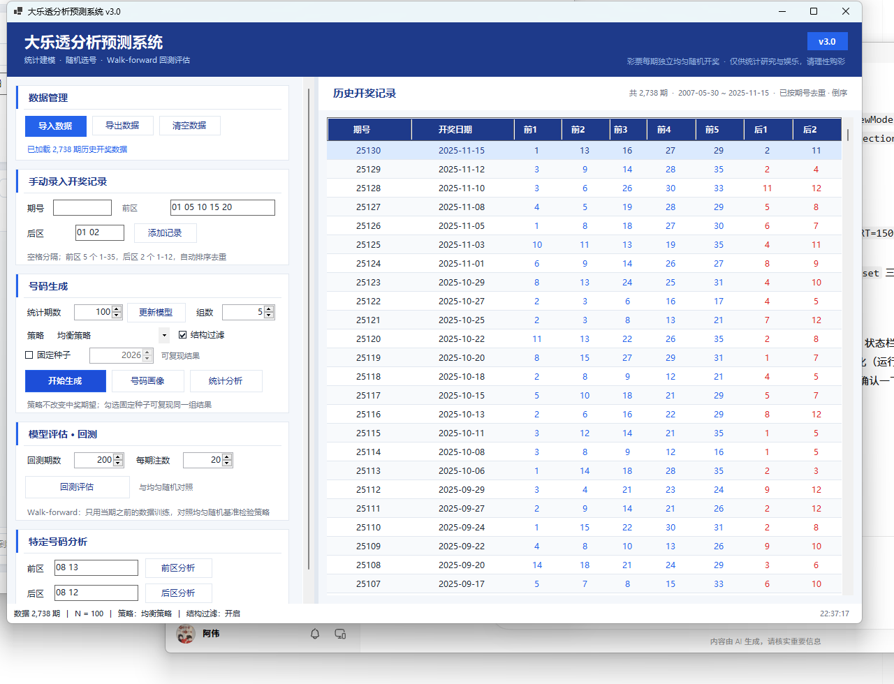
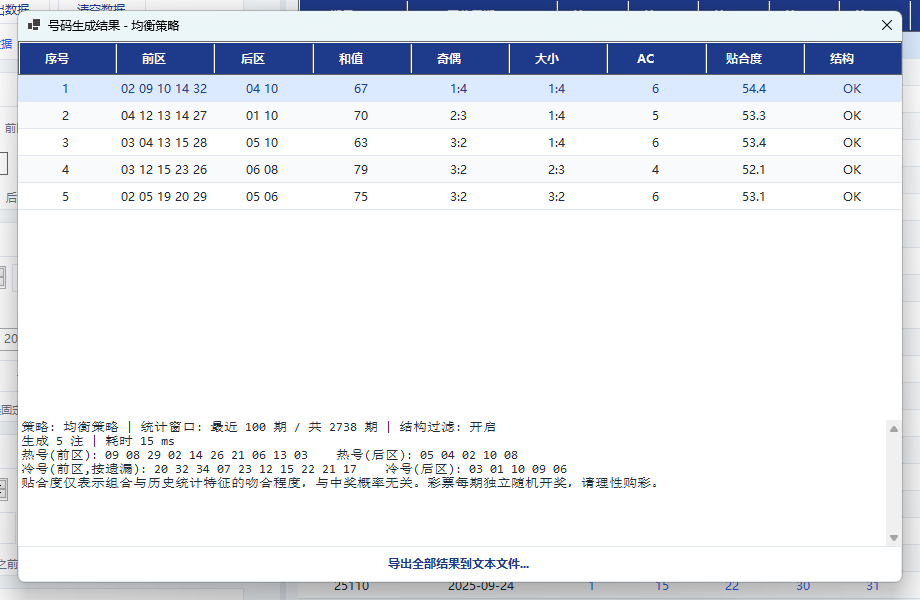

# LotteryTool · 大乐透统计分析与选号工具

> **v3.0.1** · [GitHub 仓库](https://github.com/chan3263/LotteryTool) · [MIT 许可证](LICENSE) · .NET 8 WinForms

一个基于 .NET 8 WinForms 的大乐透数据分析工具，集成数据管理、号码统计画像、多策略随机选号、组合结构过滤与 **Walk-forward 回测评估**。

> **定位说明**：v3.0 起本工具不再宣称「预测中奖」。大乐透每期开奖是独立、均匀的随机事件，任何基于历史数据的策略都无法提高中奖概率。本工具的价值在于：把统计做对、把生成做稳，并用回测如实展示「策略与随机基准没有差异」这一事实。仅供统计研究与娱乐。

## 目录

[快速开始](#快速开始) · [功能特性](#功能特性) · [界面预览](#界面预览) · [使用方法](#使用方法) · [数据格式](#数据格式) · [参数说明](#参数说明) · [算法原理](#算法原理) · [回测结论](#回测结论) · [项目结构](#项目结构) · [版本历史](#版本历史) · [常见问题](#常见问题) · [启动失败排查](#启动失败排查) · [许可证与免责声明](#许可证与免责声明)

---

## 快速开始

### 环境要求

| 项目 | 要求 |
|---|---|
| 操作系统 | Windows 10 / 11（WinForms 仅支持 Windows） |
| 运行依赖 | .NET 8 Desktop Runtime（`Microsoft.WindowsDesktop.App 8.x`） |
| 开发构建 | .NET 8 SDK，或 Visual Studio 2022 17.8+ |
| 目标框架 | `net8.0-windows`，`Nullable=enable`，`UseWindowsForms=true` |

### 从源码构建运行

```bash
git clone https://github.com/chan3263/LotteryTool.git
cd LotteryTool
dotnet build -c Release
dotnet run --project LotteryTool.csproj
```

也可以直接双击编译产物 `bin/Release/net8.0-windows/LotteryTool.exe`。

数据文件说明：

- `大乐透数据.txt` 通过 csproj 的 `CopyToOutputDirectory=PreserveNewest` 随编译复制到输出目录
- 程序启动**自动加载**该文件（规范化后 2738 期），无需手动导入
- 若单独分发 exe，请把 `大乐透数据.txt` 与 exe 放在同一目录；文件缺失时程序仍可启动，可用「导入数据」手动加载

### 编译验证

```bash
dotnet build -c Release
```

当前版本为 **0 警告 0 错误**。

---

## 功能特性

### 数据管理
- **自动加载**：启动时读取随附的 `大乐透数据.txt`
- **导入 / 导出**：Tab 或空格分隔文本；导出时自动去重、按日期排序、UTF-8 输出
- **合并去重**：按期号去重，重复导入不会重复计数
- **格式兼容**：`2025-11-15`、`2025/10/29`、`2007/6/9` 等日期格式，以及 `01` / `8` 混用的号码位数
- **数据校验**：前区 1-35 五个不重复、后区 1-12 两个不重复，自动升序；单行错误不影响整文件
- **质量报告**：导入时显示读取行数、有效期数、跳过行数、剔除的重复条数

### 号码生成（v3.0 重写）
- **4 种策略**：均衡策略（默认）、均匀随机（基准）、热号加权、冷号回补
- **结构过滤**：和值、奇偶比、大小比、连号对数、AC 值、与上期重复数
- **组合去重**：大批量生成时自动跳过重复组合
- **可复现随机源**：勾选「固定种子」后同种子结果完全一致；不同策略使用独立随机流
- **批量生成**：1 ~ 20000 注，结果以表格展示并可导出
- **可解释评分**：0~100 的「贴合度」，表示组合与历史统计特征的吻合程度（**与中奖概率无关**）

### 号码画像与统计
- 每个号码的估计出现率、提升比、总次数、窗口次数、当前遗漏、最大遗漏、平均间隔、近 10 期热度
- 热号 = 加权频率高；冷号 = **当前遗漏期数大**（而非概率最低，更符合彩票分析习惯）
- 全量历史频率统计、特定号码关联分析

### Walk-forward 回测（v3.0 核心新增）
- 每期只用**该期之前**的数据训练，杜绝未来信息泄漏
- 与「施加相同结构过滤的均匀随机选号」对照
- 输出平均命中数、命中分布、一等奖次数及理论期望对照
- 结论如实说明：历史数据无法预测未来开奖

---

## 界面预览

主窗口：左侧卡片式控制区（一屏完整显示），右侧历史开奖表格，前区号码蓝字、后区号码红字。



号码生成结果窗口：表格展示 5 注号码、贴合度与摘要信息，底部可导出。



界面要点：
- 左右分栏，左侧控制区固定宽度、右侧数据表自适应窗口缩放
- 卡片式分组，主操作按钮蓝色强调；深蓝标题栏 + 版本徽标
- 表头深蓝白字、交替行浅灰；日期统一 `yyyy-MM-dd`
- 窗口默认约 1240×900，小屏幕自动限制在工作区内，可最大化

---

## 使用方法

1. **启动即加载**：程序自动读取随附数据，状态栏显示当前期数、N 值、策略
2. **选号生成**：设置 N 期数（默认 100）、组数、策略，点击「开始生成」
   - 勾选「结构过滤」可排除全奇、全小、和值极端、连号过多等罕见形态
   - 勾选「固定种子」并设置数值，可复现同一批结果；更换种子即换一批
3. **号码画像**：查看各号码的出现率、提升比、遗漏情况
4. **回测评估**：设置回测期数与每期注数，点击「回测评估」，查看模型策略与随机基准的对照报告
5. **特定号码分析**：输入目标号码，查看匹配期数与伴随号码频率
6. **导入新数据**：点击「导入数据」，可与现有数据合并去重

---

## 数据格式

文本文件，每行一期，字段用 **Tab** 或空格分隔，无表头亦可：

```
期号  开奖日期  前区1 前区2 前区3 前区4 前区5  后区1 后区2
```

示例（以下两种写法都可以被正确解析）：

```
25130	2025-11-15	01	13	16	27	29	02	11
25123	2025/10/29	8	13	24	25	31	4	10
```

解析规则：

| 字段 | 规则 |
|---|---|
| 期号 | 任意字符串（含中文），用于去重；导出时保留 |
| 日期 | `yyyy-M-d` / `yyyy/M/d`，月日可 1~2 位 |
| 前区 | 5 个 1~35 的不重复整数，自动升序 |
| 后区 | 2 个 1~12 的不重复整数，自动升序 |
| 编码 | UTF-8（含 BOM）/ ANSI 均可 |

### 随附数据

项目根目录下的 `大乐透数据.txt` 共 **2798 行**，覆盖 2007-05-30 ~ 2025-11-15。其中 **60 行是完全重复的冗余记录**（30 个期号各重复 3 次），v3.0 会自动剔除，规范化后为 **2738 期有效数据**。

> 数据为公开开奖记录的整理结果，仅供统计研究与功能演示。请以官方公布的开奖信息为准；如需正式分析，建议导入自行核对过的数据文件。

---

## 参数说明

以下是代码中的实际默认值（见 `Models/PredictionOptions.cs` 与 `MainForm.cs`）：

| 参数 | 默认值 | 说明 |
|---|---|---|
| 统计期数 N | 100 | 时间衰减窗口，范围 5~50000，实际取 `min(N, 总期数)` |
| 生成组数 | 5 | 单次生成注数，范围 1~20000 |
| 策略 | Balanced | 均衡 / 均匀随机(基准) / 热号 / 冷号 |
| 结构过滤 | 开启 | 见下方约束表 |
| 组合去重 | 开启 | 大批量生成时跳过重复组合 |
| 固定种子 | 关闭（默认 2026） | 勾选后同种子结果完全可复现 |
| 权重强度 γ | 1.0（0~2） | 0 等价于均匀随机；越大越偏向模型分布 |
| 半衰期 | 0 → 自动 `N/3` | 显式设为正数则覆盖；越小越看重近期 |
| Dirichlet α | 20 | 边际概率向均匀收缩的强度 |
| 共现收缩 β | 25 | 号码对条件概率向边际收缩的强度 |
| 单注最大尝试 | 200 | 结构过滤 / 去重失败时的兜底上限 |
| 回测期数 | 200 | 范围 10~2000 |
| 每期注数 | 20 | 范围 1~200 |

### 结构约束默认值

| 约束 | 范围 | 说明 |
|---|---|---|
| 前区和值 | 55 ~ 130 | 理论均值 90，标准差约 22.6 |
| 后区和值 | 5 ~ 21 | 理论均值 13 |
| 前区奇数个数 | 1 ~ 4 | 排除全奇 / 全偶 |
| 前区大号（≥18）个数 | 1 ~ 4 | 排除全大 / 全小 |
| 连号对数 | ≤ 2 | 如 `08 09` 记 1 对 |
| AC 值 | ≥ 3 | 两两差的不同值个数 − (n−1) |
| 与上期前区重复 | ≤ 3 | 避免与上期高度雷同 |

> 采用拒绝采样，超过尝试上限时软降级并计数，保证不死循环。**形态过滤不改变任何号码的中奖概率。**

---

## 算法原理

v3.0 的流水线：

```
历史数据 → 时间衰减加权 → Dirichlet 平滑的边际概率 → 共现 β 收缩估计
        → 按策略构建权重 → Gumbel-top-k 无放回抽样 → 结构约束 / 去重
        → 可解释评分 → Walk-forward 回测（与均匀随机基准对照）
```

八个要点：

1. **时间衰减加权**：窗口内按半衰期指数衰减，替代 v2.0 的硬截断，避免窗口边界跳变
2. **Dirichlet 平滑**：`p_i = (c_i + α·u_i)/(每期号码数 + α)`，抑制小样本过拟合，概率严格归一
3. **共现收缩估计**：`P(A|B) = (co(A,B) + β·p_A)/(c_B + β)`，50 期窗口内号码对期望共现不足 1 次，必须收缩回边际
4. **Gumbel-top-k 抽样**：`key_i = E_i / w_i`（`E_i ~ Exp(1)`）取最小 k 个，数学上严格等价于 Plackett-Luce 依次无放回抽样，一次 O(n log n) 生成整注
5. **策略权重**：四种策略使用不同信号（窗口频率 / 当前遗漏 / 平滑边际 / 全 1），裁剪到 `[0.2, 5]`
6. **结构约束**：和值、奇偶、大小、连号、AC、与上期重复
7. **可解释评分**：`50 + 32·tanh(...)` + 结构修正，50 分 ≈ 与均匀随机基准相当
8. **Walk-forward 回测**：只用每期之前的数据训练，理论期望前区 `25/35 ≈ 0.7143`、后区 `4/12 ≈ 0.3333`

完整的公式推导、概率尺度约定、v2.0 缺陷对照与验证清单见 **[docs/ALGORITHM.md](docs/ALGORITHM.md)**。

> 类名 `BayesianLotteryModel` 为保持兼容而沿用，v3.0 起**已不是**朴素贝叶斯分类器。

---

## 回测结论

在 2738 期数据、N=100、**200 期 × 20 注（共 4000 注）** 的一次实测中：

| 指标 | 模型策略 | 随机基准 | 理论期望 |
|---|---|---|---|
| 前区平均命中 | 0.7145 | 0.7047 | 0.7143 |
| 后区平均命中 | 0.3245 | 0.3257 | 0.3333 |
| 总平均命中 | 1.0390 | 1.0305 | 1.0476 |
| 一等奖 (5+2) | 0 次 | 0 次 | — |

前区平均命中差 **+0.0098 个/注**，属于抽样波动；样本量越大越趋近于 0。**结论：历史数据无法预测未来开奖，所有选号策略的期望中奖率相同。**

作为对照，权重本身确实生效（各 2000 注、关闭结构过滤）：

| 策略 | 平均窗口出现次数 | 平均当前遗漏 |
|---|---|---|
| 均匀随机（基准） | 14.23 | 6.83 期 |
| 热号加权 | **15.63** | 6.67 期 |
| 冷号回补 | 14.09 | **11.27 期** |
| 均衡策略 | 14.29 | 6.81 期 |

热号确实更偏高频、冷号确实更偏长遗漏——但这只是「按不同分布生成号码」，**不改变期望中奖率**。

**实测性能**（2738 期，N=100）：生成 20000 注约 **146 ms** 且全部唯一、结构约束 100% 满足；200 期 × 20 注回测约 **87 ms**。数值随机器与随机种子略有浮动。

---

## 项目结构

```
LotteryTool/
├── Models/
│   ├── LotteryData.cs              # 开奖数据模型
│   ├── PredictionResult.cs         # 单注结果 + 结构特征 + 贴合度
│   ├── BayesianPredictionResult.cs # 批量结果汇总与文本报告
│   ├── PredictionOptions.cs        # 策略枚举 / 生成参数 / 结构约束
│   ├── NumberStatistic.cs          # 号码统计画像
│   └── BacktestResult.cs           # 回测结果与报告
├── Services/
│   ├── DataService.cs                    # 加载/保存/校验/去重/合并
│   ├── BayesianLotteryModel.cs           # 引擎主逻辑（公共 API、生成、回测）
│   └── BayesianLotteryModel.Stats.cs     # 统计计算、权重、抽样、评分、约束
├── docs/
│   ├── ALGORITHM.md               # 算法原理与验证细节
│   └── screenshots/               # 界面截图
├── MainForm.cs                    # UI 层（卡片式布局、主题样式、业务交互）
├── Program.cs                     # 入口（高 DPI + 全局异常兜底与错误日志）
├── 大乐透数据.txt                 # 随附历史数据（编译复制到输出目录）
├── LotteryTool.csproj
├── LotteryTool.sln
├── README.md
├── CHANGELOG.md                   # 更新日志
├── CONTRIBUTING.md                # 贡献指南
├── LICENSE                        # MIT
└── .gitignore
```

---

## 版本历史

| 版本 | 日期 | 要点 |
|---|---|---|
| v3.0.1 | 2026-11-21 | 修复启动静默退出；界面重做与全局异常兜底 |
| v3.0 | 2026-11-21 | 算法引擎重写；4 种策略、结构约束、回测、数据层加固 |
| v2.0 | 2026-09-06 | 合并两个独立工具，新增特定号码分析 |
| v1.0 | — | 三个独立项目 |

完整变更记录见 [CHANGELOG.md](CHANGELOG.md)。

---

## 常见问题

**Q：这个工具能提高中奖率吗？**
不能。开奖是独立均匀随机事件，任何策略的期望中奖率都相同。回测功能就是为了如实展示这一点。

**Q：「贴合度」高的号码更容易中奖吗？**
不是。贴合度只表示组合与历史统计特征的吻合程度，不是中奖置信度。

**Q：为什么勾选固定种子后，连续两次生成结果一样？**
这是设计行为：固定种子每次生成都从该种子重新开始，便于复现。取消勾选后复用同一条随机流，连续点击会得到不同结果。

**Q：切换策略后结果完全没变？**
v3.0.1 已修复早期版本「权重按模型默认选项计算」的问题。现在权重按本次调用的策略显式构建；可用「号码画像」或回测报告观察策略倾向。

**Q：回测需要多少期数据？**
至少 **31 期**（`MinTrain = 30`）。数据量太少时回测报告会给出提示。

**Q：导入自己的数据后，原有数据会丢失吗？**
不会。导入采用按期号合并去重，重复记录自动剔除。

**Q：想改算法参数，改哪里？**
`Models/PredictionOptions.cs` 是参数默认值，`Services/BayesianLotteryModel.Stats.cs` 是统计与权重实现。改完请按 [CONTRIBUTING.md](CONTRIBUTING.md) 的验证清单跑回归。

---

## 启动失败排查

程序为 `WinExe`（无控制台），若启动异常会**弹窗提示**，同时把完整堆栈写入程序目录下的 `startup_error.log`。若窗口未出现，请检查该文件；常见原因：

- 缺少 .NET 8 Desktop Runtime（需 `Microsoft.WindowsDesktop.App 8.x`）
- 数据文件被其他程序占用或权限不足（只影响自动加载，不影响启动）
- 显示器 DPI 缩放导致窗口超出工作区（v3.0.1 已自动限制到工作区内）

日志定位后可直接对照行号排查；`startup_error.log` 可安全删除，下次出错会重新生成。若既无弹窗也无日志，可查看 Windows 事件日志 `Application` 中 `.NET Runtime` 的 **Id 1026** 事件（含完整堆栈）。

---

## 许可证与免责声明

本项目采用 [MIT 许可证](LICENSE)，Copyright (c) 2026 chan3263。随附的 `大乐透数据.txt` 为公开开奖记录整理，请以官方发布信息为准。

本工具仅用于数据分析和学习研究。彩票开奖为独立随机事件，任何预测、选号或过滤方法都不能保证中奖，也不改变期望中奖率。工具内置的回测功能正是为了如实说明这一点。预测结果不构成投注建议，请理性购彩、量力而行。
